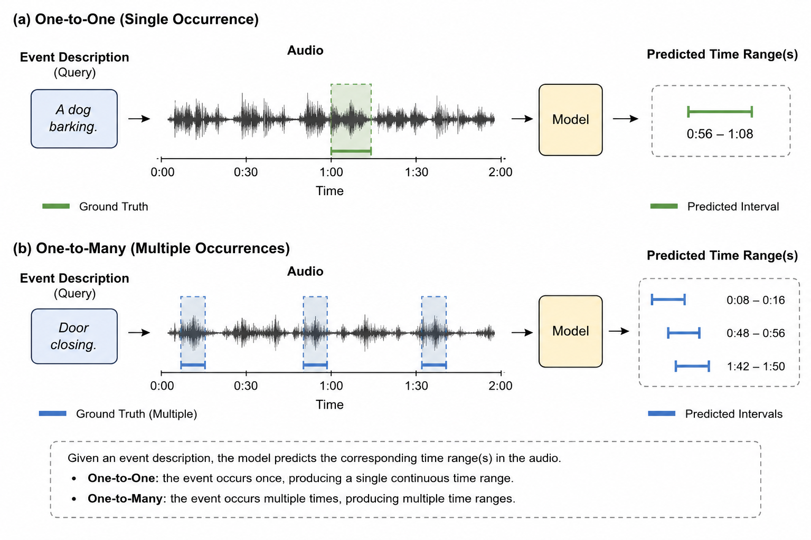
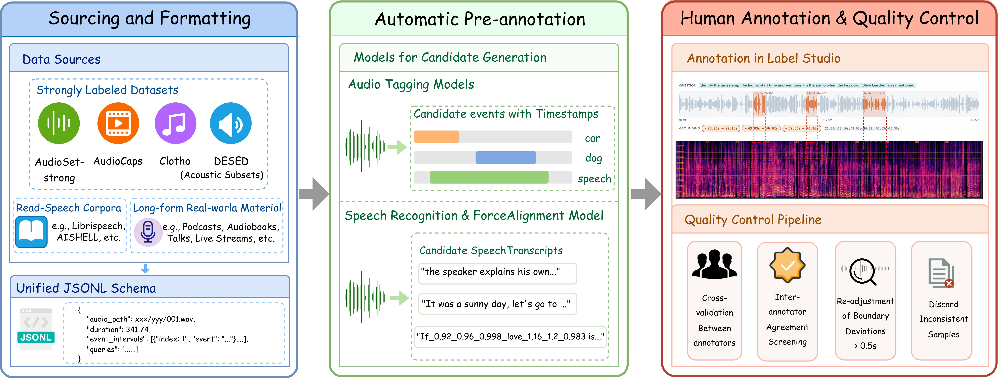

<div align="center">

# TAG-Bench

### Benchmarking Temporal Audio Grounding in Large Audio Language Models

**Hearing what. Knowing when.**

Yuhang Dai<sup>†</sup> · Xin Shu<sup>†</sup> · Zengxi Li · Lei Xie · Xiangang Li · Jianwei Yu  
**Alibaba Token Foundry**  
<sup>†</sup> Equal contribution

[📄 Paper](https://arxiv.org/abs/2609.01542v2) · [🎧 Audio Demos](https://aslp-lab.github.io/TAG-Bench.github.io/) · [📊 Results](#results) · [🚀 Quick Start](#quick-start) · [中文](README_zh.md)

</div>

## Overview

Large audio language models can describe what they hear. **Can they tell us exactly when it happens, and find every occurrence?**

We introduce **TAG-Bench**, a benchmark for temporal audio grounding. Given an audio recording and a natural-language query, a model must return all time intervals that match the query. TAG-Bench evaluates this ability across spoken words, acoustic events, semantic content, and emotion, including long recordings and queries with multiple occurrences.

| Human-verified queries | Audio duration | Diagnostic subsets | Evaluated systems | Multi-target queries |
| :---: | :---: | :---: | :---: | :---: |
| **1,750** | **149.5 hours** | **8** | **21** | **22.1%** |

<p align="center">
  
</p>

*Temporal audio grounding requires both accurate boundaries and complete recovery of matching occurrences. Single-target and multi-target queries share the same timestamp output format.*

## Highlights

- **Diverse grounding queries.** Eight subsets cover word-level localization, acoustic events and descriptions, semantics, underspecified semantic queries, emotion, and two long-audio settings.
- **Long-form audio.** Recordings extend to **20 minutes**, testing localization across a broad range of audio durations.
- **Every occurrence matters.** **387 queries** contain multiple target intervals, with up to **18 occurrences** in a single query.
- **A common evaluation protocol.** We compare **21 systems** using interval overlap, strict localization recall, occurrence counts, and output-format reliability.
- **Human-verified annotations.** Automatic candidate generation is followed by human refinement and quality control.

## Benchmark

TAG-Bench contains six short-audio subsets and two long-audio subsets. Each query is paired with one recording and one or more annotated time intervals.

| Subset | Queries | Grounding target |
| --- | ---: | --- |
| Word | 279 | A specific spoken word |
| Acoustic event | 301 | A recognizable sound event |
| Acoustic description | 260 | Acoustic content described in natural language |
| Semantic | 180 | The meaning of spoken content |
| Rough semantic | 161 | Abstract or underspecified semantic content |
| Emotion | 129 | An emotion expressed in speech |
| Long — semantic | 180 | Semantic content in long recordings |
| Long — acoustic description | 260 | Described acoustic content in long recordings |
| **Total** | **1,750** | **1,363 single-target + 387 multi-target queries** |

### Construction

Our construction pipeline combines source collection and formatting, automatic pre-annotation, and human annotation with quality control. Annotators refine candidate intervals using waveform and spectrogram views, followed by cross-validation, agreement screening, and boundary review.

<p align="center">
  
</p>

The subsets differ in source composition as well as query type and duration. Cross-subset results provide diagnostic comparisons rather than controlled estimates of any single factor.

## Results

We evaluate 21 systems spanning general-purpose audio language models, omni-modal systems, and temporal-awareness experts. The complete leaderboard below ranks every evaluated system by overall mIoU, using the results reported in the [paper](https://arxiv.org/abs/2609.01542v2).

### Full leaderboard

| Rank | Model | mIoU ↑ | R@0.3 ↑ | R@0.5 ↑ | R@0.7 ↑ | One-to-one ↑ | One-to-many ↑ | Fail ↓ |
| ---: | --- | ---: | ---: | ---: | ---: | ---: | ---: | ---: |
| 1 | FireRedAudio | **31.2** | **39.7** | **30.8** | **21.5** | **34.1** | 21.0 | 15.1 |
| 2 | MOSS-Audio-8B-Thinking | 29.6 | 38.6 | 25.5 | 18.2 | 31.4 | **23.6** | 0.1 |
| 3 | MOSS-Audio-4B-Thinking | 27.8 | 36.3 | 24.1 | 16.2 | 29.5 | 22.0 | 0.9 |
| 4 | Gemini-3.1-Pro | 26.4 | 35.6 | 24.0 | 13.7 | 27.9 | 20.9 | 0.1 |
| 5 | LAT-Audio | 19.7 | 27.0 | 16.2 | 8.3 | 20.7 | 16.2 | 0.2 |
| 6 | MOSS-Audio-4B-Instruct | 14.6 | 19.7 | 10.3 | 5.9 | 15.3 | 12.2 | 3.5 |
| 7 | MOSS-Audio-8B-Instruct | 12.8 | 17.1 | 9.5 | 5.3 | 13.7 | 9.4 | 11.2 |
| 8 | TimeAudio | 12.4 | 13.7 | 6.9 | 3.1 | 12.5 | 12.2 | 2.1 |
| 9 | MiMo-Audio-7B-Instruct | 12.2 | 17.5 | 9.0 | 3.4 | 12.8 | 9.9 | 1.9 |
| 10 | Step-Audio-R1 | 11.0 | 15.2 | 6.6 | 2.0 | 11.4 | 9.2 | 0.1 |
| 11 | Audio Flamingo 3 | 8.7 | 12.1 | 5.9 | 2.0 | 8.9 | 7.9 | 0.1 |
| 12 | Step-Audio-2-mini | 6.3 | 7.5 | 2.1 | 0.6 | 6.7 | 4.9 | 24.1 |
| 13 | MiDashengLM-7B | 4.6 | 6.2 | 1.2 | 0.2 | 4.2 | 5.8 | 28.7 |
| 14 | GLM-4-Voice-9B | 3.4 | 4.1 | 1.4 | 0.3 | 3.2 | 4.1 | 33.5 |
| 15 | AF2 Sound-CoT | 2.9 | 3.4 | 0.9 | 0.2 | 2.8 | 3.3 | 0.1 |
| 16 | Step-Audio-2-mini-Think | 2.7 | 2.1 | 0.9 | 0.4 | 3.0 | 1.7 | 27.6 |
| 17 | Step-Audio-2-mini-Base | 2.0 | 1.9 | 0.7 | 0.1 | 2.3 | 1.1 | 55.5 |
| 18 | LLaMA-Omni2-14B | 1.6 | 1.9 | 0.6 | 0.2 | 1.9 | 0.7 | 60.0 |
| 19 | Kimi-Audio-7B | 1.4 | 1.4 | 0.5 | 0.2 | 1.5 | 0.9 | 26.9 |
| 20 | LLaMA-3.1-8B-Omni | 0.6 | 0.6 | 0.2 | 0.2 | 0.6 | 0.4 | 69.2 |
| 21 | Audio Flamingo 2 | 0.5 | 0.7 | 0.4 | 0.1 | 0.6 | 0.1 | 0.1 |

All values are percentages. One-to-one and one-to-many report mIoU on single-target and multi-target queries. Fail is the percentage of responses without a recoverable timestamp. Gemini-3.1-Pro has 1,749 evaluated queries; the other systems have 1,750.

### Key findings

- **Precise localization remains difficult.** FireRedAudio leads overall with **31.2 mIoU**, but only **21.5%** of its answers reach IoU ≥ 0.7.
- **Long audio remains challenging.** FireRedAudio achieves **20.6 / 21.7 mIoU** on long semantic / long acoustic-description queries and is the only evaluated system above 20 on both subsets.
- **Models miss repeated occurrences.** Every evaluated system under-reports occurrences on multi-target queries. The highest count accuracy is **13.2%**, achieved by Step-Audio-R1.
- **Output reliability is a separate dimension.** Parsing failures count as misses for overlap and count metrics. Midpoint MAE is reported together with coverage so that conditional error can be interpreted correctly.

### Evaluation metrics

| Metric | What it measures |
| --- | --- |
| **mIoU** | Overlap between the unions of predicted and ground-truth intervals |
| **Recall@0.3 / 0.5 / 0.7** | Fraction of queries meeting each IoU threshold |
| **gIoU** | Interval overlap with a penalty for temporal displacement |
| **Midpoint MAE + coverage** | Localization error in seconds, alongside the fraction of queries with a valid prediction |
| **Count accuracy / under / over** | Whether all occurrences are enumerated, independent of boundary precision |
| **Parsing-failure rate** | Fraction of responses without a recoverable timestamp |

Metrics are averaged over queries, with breakdowns by subset and target multiplicity. See the [evaluation protocol](documentation/evaluation.md) for definitions and scoring conventions.

## Audio Demos

Explore real benchmark recordings and compare human annotations with predictions from FireRedAudio, MOSS-Audio-8B-Thinking, and Gemini-3.1-Pro.

| Example | What to listen for |
| --- | --- |
| **Repeated acoustic events** | Four door-opening and door-closing events: finding all occurrences versus predicting one broad span |
| **Word-level precision** | The word “WELL”: how a fraction of a second changes localization quality |
| **Emotion in speech** | Disbelief and sympathy within a spoken conversation |

The [interactive demo](docs/index.html) includes synchronized waveforms, clickable time intervals, model comparisons, and searchable result tables. To view it locally:

```bash
python -m http.server 8000 --directory docs
```

Open **http://localhost:8000** and select an example. The demos use saved predictions and run entirely in the browser.

The link of our demo page is：https://aslp-lab.github.io/TAG-Bench.github.io/
## Quick Start

The evaluation toolkit requires **Python 3.10+** and has no runtime dependencies. From the repository root, run the included format example:

```bash
python -m tagbench run \
  --annotations examples/annotations.jsonl \
  --predictions examples/predictions.jsonl \
  --output-dir outputs/example
```

This synthetic three-query example produces **mIoU 50.00** and **MAE coverage 66.67%**. To install the command-line tool:

```bash
python -m pip install -e .
tagbench --help
```

### Evaluate your model

Prepare annotation and prediction JSONL files with matching sample IDs. For example:

**Annotation**

```json
{"id":"sample-1","timestamp":"1s~3s;5s~7s","task_tag":"acoustic event","multi_target":true}
```

**Prediction**

```json
{"id":"sample-1","response":"1s~3s;5s~7s"}
```

Run evaluation on your files:

```bash
python -m tagbench run \
  --annotations /path/to/annotations.jsonl \
  --predictions /path/to/predictions.jsonl \
  --output-dir outputs/my-model
```

The toolkit aligns samples, extracts timestamps, and saves aggregate metrics, per-query scores, normalized responses, and a coverage audit. Reports include overall, per-subset, and single-/multi-target results. Overlap and rate metrics are stored as fractions; MAE is measured in seconds.

For model-specific response conventions, use `--model`, such as `--model moss-audio-8b-thinking`. For canonical interval strings or arrays, use `--parser strict`. Missing predictions raise an error by default; `--missing empty` explicitly scores them as empty predictions.

[Input formats and alignment](documentation/data-format.md) · [Evaluation protocol](documentation/evaluation.md) · [All documentation](documentation/README.md)

## Citation

If you find TAG-Bench useful in your research, please cite:

```bibtex
@misc{dai2026tagbench,
  title={TAG-Bench: Benchmarking Temporal Audio Grounding in Large Audio Language Models},
  author={Yuhang Dai and Xin Shu and Zengxi Li and Lei Xie and Xiangang Li and Jianwei Yu},
  year={2026},
  eprint={2609.01542},
  archivePrefix={arXiv},
  primaryClass={eess.AS},
  url={https://arxiv.org/abs/2609.01542}
}
```
