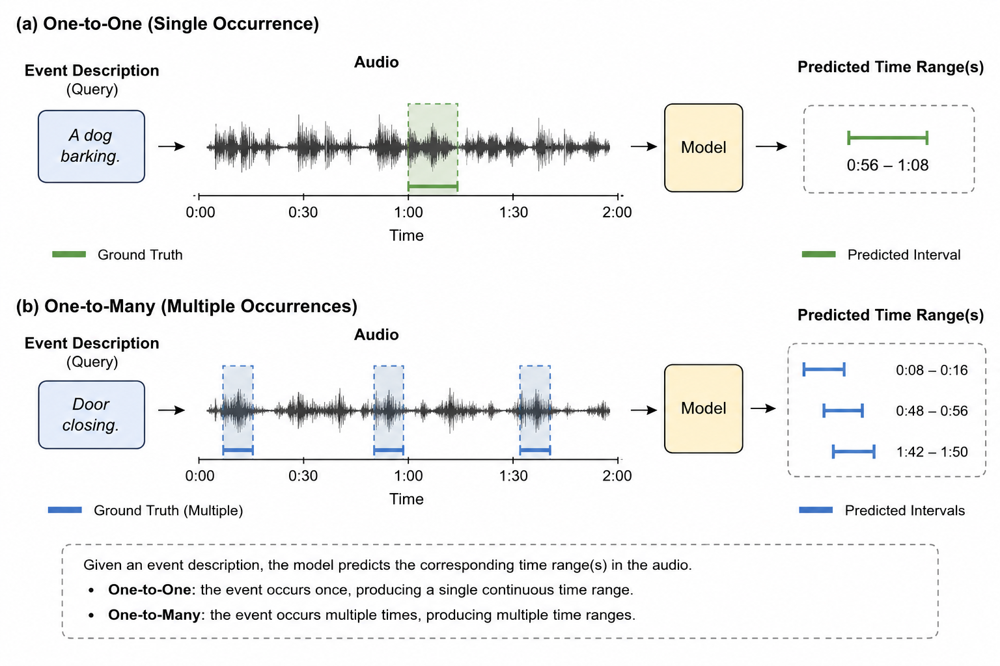
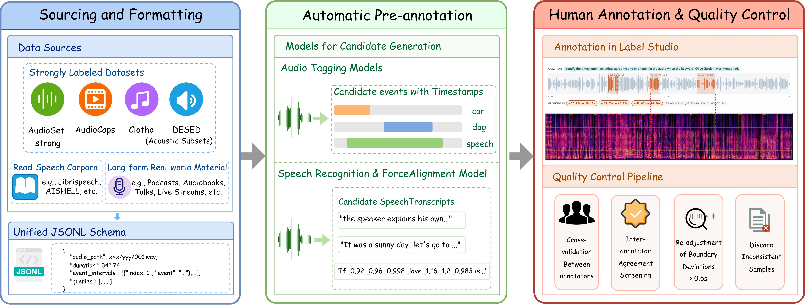

<div align="center">

# TAG-Bench

### 面向大型音频语言模型的时间定位评测基准

**听懂发生了什么，定位发生在何时。**

Yuhang Dai<sup>†</sup> · Xin Shu<sup>†</sup> · Zengxi Li · Lei Xie · Xiangang Li · Jianwei Yu  
**Alibaba Token Foundry**  
<sup>†</sup> 同等贡献

[📄 论文](https://arxiv.org/abs/2609.01542v2) · [🎧 音频示例](https://aslp-lab.github.io/TAG-Bench.github.io/) · [📊 实验结果](#实验结果) · [🚀 快速开始](#快速开始) · [English](README.md)

</div>

## 项目介绍

大型音频语言模型已经能够描述音频中的内容。**但它们能否准确指出这些内容发生在何时，并找出每一次出现？**

我们提出 **TAG-Bench**，用于评估音频语言模型的时间定位能力。给定一段音频和自然语言查询，模型需要输出与查询匹配的全部时间区间。TAG-Bench 覆盖词汇、声学事件、语义内容和情绪，包含长音频场景及同一目标多次出现的查询。

| 人工核验查询 | 音频总时长 | 诊断子集 | 评测系统 | 多目标查询占比 |
| :---: | :---: | :---: | :---: | :---: |
| **1,750** | **149.5 小时** | **8** | **21** | **22.1%** |

<p align="center">
  
</p>

*时间定位既要求准确识别事件边界，也要求完整找出所有匹配片段。单目标与多目标查询采用相同的时间区间输出格式。*

## 项目特点

- **多种查询类型。** 八个子集覆盖词级定位、声学事件及描述、语义、模糊语义、情绪，以及两类长音频任务。
- **长音频定位。** 录音最长达到 **20 分钟**，检验模型在不同音频时长下的定位能力。
- **完整查找重复事件。** **387 条查询**包含多个目标区间，单条查询最多有 **18 次出现**。
- **统一评测协议。** 在 **21 个系统**上同时考察区间重叠、严格定位召回、事件计数和时间戳输出可靠性。
- **人工核验标注。** 自动生成候选标注后，进行人工修订、交叉核验与质量控制。

## 基准构成

TAG-Bench 包含六个短音频子集和两个长音频子集。每条查询对应一段录音，以及一个或多个标注时间区间。

| 子集 | 查询数 | 定位目标 |
| --- | ---: | --- |
| 词汇 | 279 | 音频中的特定词汇 |
| 声学事件 | 301 | 可识别的声音事件 |
| 声学描述 | 260 | 自然语言描述的声音内容 |
| 语义 | 180 | 语音表达的语义内容 |
| 模糊语义 | 161 | 抽象或不完全明确的语义内容 |
| 情绪 | 129 | 语音中表达的情绪 |
| 长音频 — 语义 | 180 | 长录音中的语义内容 |
| 长音频 — 声学描述 | 260 | 长录音中描述的声音内容 |
| **合计** | **1,750** | **1,363 条单目标查询 + 387 条多目标查询** |

### 数据构建

数据构建分为来源收集与格式统一、自动预标注、人工标注与质量控制三个阶段。标注人员结合波形和频谱图修订候选区间，再进行交叉核验、一致性筛查和边界复核。

<p align="center">
  
</p>

不同子集在数据来源、查询类型和音频时长上均存在差异。跨子集结果用于诊断模型表现，不应直接解释为某一单独因素的因果影响。

## 实验结果

我们评测了 21 个系统，涵盖通用音频语言模型、全模态系统和时间感知专家模型。下表展示完整排行榜，按整体 mIoU 从高到低排序；结果来自[论文](https://arxiv.org/abs/2609.01542v2)。

### 完整排行榜

| 排名 | 模型 | mIoU ↑ | R@0.3 ↑ | R@0.5 ↑ | R@0.7 ↑ | 单目标 ↑ | 多目标 ↑ | 解析失败率 ↓ |
| ---: | --- | ---: | ---: | ---: | ---: | ---: | ---: | ---: |
| 1 | FireRedAudio | **31.2** | **39.7** | **30.8** | **21.5** | **34.1** | 21.0 | 15.1 |
| 2 | MOSS-Audio-8B-Thinking | 29.6 | 38.6 | 25.5 | 18.2 | 31.4 | **23.6** | 0.1 |
| 3 | MOSS-Audio-4B-Thinking | 27.8 | 36.3 | 24.1 | 16.2 | 29.5 | 22.0 | 0.9 |
| 4 | Gemini-3.1-Pro | 26.4 | 35.6 | 24.0 | 13.7 | 27.9 | 20.9 | 0.1 |
| 5 | LAT-Audio | 19.7 | 27.0 | 16.2 | 8.3 | 20.7 | 16.2 | 0.2 |
| 6 | MOSS-Audio-4B-Instruct | 14.6 | 19.7 | 10.3 | 5.9 | 15.3 | 12.2 | 3.5 |
| 7 | MOSS-Audio-8B-Instruct | 12.8 | 17.1 | 9.5 | 5.3 | 13.7 | 9.4 | 11.2 |
| 8 | TimeAudio | 12.4 | 13.7 | 6.9 | 3.1 | 12.5 | 12.2 | 2.1 |
| 9 | MiMo-Audio-7B-Instruct | 12.2 | 17.5 | 9.0 | 3.4 | 12.8 | 9.9 | 1.9 |
| 10 | Step-Audio-R1 | 11.0 | 15.2 | 6.6 | 2.0 | 11.4 | 9.2 | 0.1 |
| 11 | Audio Flamingo 3 | 8.7 | 12.1 | 5.9 | 2.0 | 8.9 | 7.9 | 0.1 |
| 12 | Step-Audio-2-mini | 6.3 | 7.5 | 2.1 | 0.6 | 6.7 | 4.9 | 24.1 |
| 13 | MiDashengLM-7B | 4.6 | 6.2 | 1.2 | 0.2 | 4.2 | 5.8 | 28.7 |
| 14 | GLM-4-Voice-9B | 3.4 | 4.1 | 1.4 | 0.3 | 3.2 | 4.1 | 33.5 |
| 15 | AF2 Sound-CoT | 2.9 | 3.4 | 0.9 | 0.2 | 2.8 | 3.3 | 0.1 |
| 16 | Step-Audio-2-mini-Think | 2.7 | 2.1 | 0.9 | 0.4 | 3.0 | 1.7 | 27.6 |
| 17 | Step-Audio-2-mini-Base | 2.0 | 1.9 | 0.7 | 0.1 | 2.3 | 1.1 | 55.5 |
| 18 | LLaMA-Omni2-14B | 1.6 | 1.9 | 0.6 | 0.2 | 1.9 | 0.7 | 60.0 |
| 19 | Kimi-Audio-7B | 1.4 | 1.4 | 0.5 | 0.2 | 1.5 | 0.9 | 26.9 |
| 20 | LLaMA-3.1-8B-Omni | 0.6 | 0.6 | 0.2 | 0.2 | 0.6 | 0.4 | 69.2 |
| 21 | Audio Flamingo 2 | 0.5 | 0.7 | 0.4 | 0.1 | 0.6 | 0.1 | 0.1 |

数值均采用百分比尺度。单目标与多目标列为相应查询上的 mIoU；解析失败率表示无法恢复有效时间戳的回答比例。Gemini-3.1-Pro 的评测样本数为 1,749，其余系统为 1,750。

### 主要发现

- **精确定位仍然困难。** FireRedAudio 以 **31.2 mIoU** 获得最高整体分数，但仅 **21.5%** 的回答达到 IoU ≥ 0.7。
- **长音频仍具挑战。** FireRedAudio 在长语义和长声学描述子集上分别达到 **20.6 / 21.7 mIoU**，是唯一在两者上均超过 20 的系统。
- **重复事件存在普遍漏报。** 所有评测系统均在多目标查询上漏报出现次数。最佳计数准确率仅为 **13.2%**，由 Step-Audio-R1 取得。
- **输出可靠性需要独立考察。** 无法解析的回答计入重叠与计数指标的失分；中点 MAE 与覆盖率成对报告，以便正确理解有效预测上的误差。

### 评测指标

| 指标 | 衡量内容 |
| --- | --- |
| **mIoU** | 预测区间并集与标注区间并集的重叠程度 |
| **Recall@0.3 / 0.5 / 0.7** | 达到各 IoU 阈值的查询比例 |
| **gIoU** | 带时间偏移惩罚的区间重叠指标 |
| **中点 MAE + 覆盖率** | 定位误差，单位为秒，并报告有有效预测的查询比例 |
| **计数准确率 / 漏报率 / 多报率** | 是否找全事件次数，与边界精度分开衡量 |
| **解析失败率** | 无法恢复有效时间戳的回答比例 |

指标按查询平均，并提供各子集及单目标/多目标分组结果。定义与计分约定见[评测协议](documentation/evaluation_zh.md)。

## 音频示例

通过真实录音，对照人工标注与 FireRedAudio、MOSS-Audio-8B-Thinking、Gemini-3.1-Pro 的预测。

| 示例 | 观察重点 |
| --- | --- |
| **重复声学事件** | 四次开关门：完整定位每次出现与输出一个宽区间的区别 |
| **词级定位** | 单词“WELL”：细小的边界偏差如何影响定位质量 |
| **语音情绪** | 定位对话中表达难以置信和同情的片段 |

[交互展示页](docs/index.html)提供同步波形、时间区间点击播放、模型对比和可检索结果表。可在本地启动：

```bash
python -m http.server 8000 --directory docs
```

打开 **http://localhost:8000** 后选择示例。展示使用已保存的预测结果，全部交互在浏览器内运行。
我们提供的demo page，链接为：https://aslp-lab.github.io/TAG-Bench.github.io/

## 快速开始

评测工具需要 **Python 3.10+**，无运行时第三方依赖。在项目根目录运行随附的格式示例：

```bash
python -m tagbench run \
  --annotations examples/annotations.jsonl \
  --predictions examples/predictions.jsonl \
  --output-dir outputs/example
```

三个合成示例的预期 mIoU 为 **50.00**，MAE 覆盖率为 **66.67%**。也可以安装命令行工具：

```bash
python -m pip install -e .
tagbench --help
```

### 评测自己的模型

准备通过样本 ID 对齐的标注与预测 JSONL 文件。例如：

**标注**

```json
{"id":"sample-1","timestamp":"1s~3s;5s~7s","task_tag":"acoustic event","multi_target":true}
```

**预测**

```json
{"id":"sample-1","response":"1s~3s;5s~7s"}
```

执行评测：

```bash
python -m tagbench run \
  --annotations /path/to/annotations.jsonl \
  --predictions /path/to/predictions.jsonl \
  --output-dir outputs/my-model
```

工具会对齐样本、解析时间戳，并保存汇总指标、逐条得分、标准化回答和覆盖情况，提供整体、各子集及单目标/多目标结果。重叠与比例指标按小数保存，MAE 单位为秒。

可用 `--model moss-audio-8b-thinking` 等参数选择对应模型的回答解析规则；标准时间区间或二维数组可用 `--parser strict`。默认情况下，缺失预测会报错；明确传入 `--missing empty` 可将缺失项按空预测计分。

[输入格式与对齐规则](documentation/data-format_zh.md) · [评测协议](documentation/evaluation_zh.md) · [全部文档](documentation/README_zh.md)

## 引用

如果 TAG-Bench 对你的研究有所帮助，欢迎引用：

```bibtex
@misc{dai2026tagbench,
  title={TAG-Bench: Benchmarking Temporal Audio Grounding in Large Audio Language Models},
  author={Yuhang Dai and Xin Shu and Zengxi Li and Lei Xie and Xiangang Li and Jianwei Yu},
  year={2026},
  eprint={2609.01542},
  archivePrefix={arXiv},
  primaryClass={eess.AS},
  url={https://arxiv.org/abs/2609.01542}
}
```
